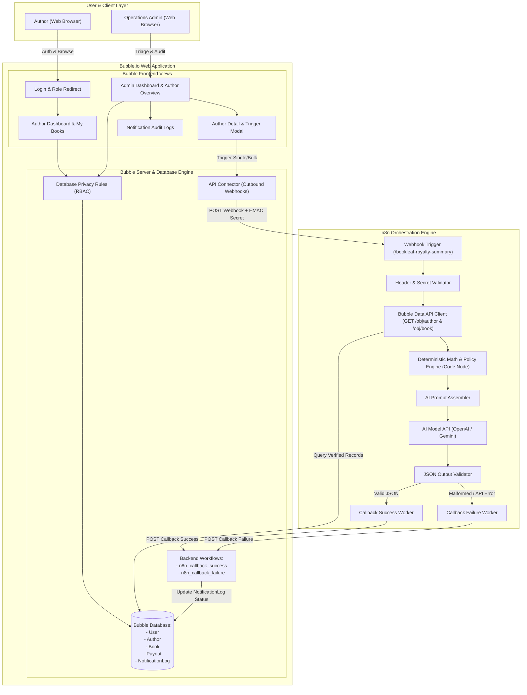
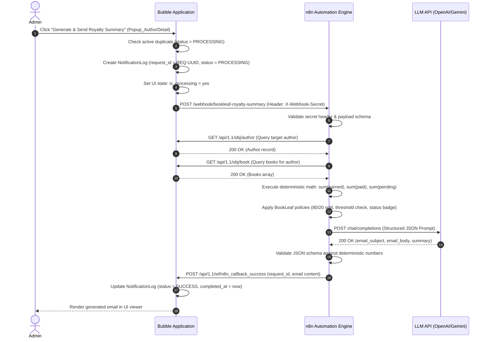

# BookLeaf Author Royalty Dashboard & Automated Notification System — End-to-End Architecture

## 1. System Overview
The BookLeaf Royalty Platform is a hybrid no-code / low-code enterprise application connecting an author-facing portal, an operations management console, an n8n workflow automation pipeline, and an AI policy engine.

The platform guarantees:
- **Strict Data Segregation**: Authors access solely their personal books and royalty metrics via database-level Privacy Rules.
- **Financial Determinism**: Royalty accruals, disbursements, and pending balances are computed mathematically from database records. The LLM never calculates or hallucinates monetary figures.
- **Policy Compliance**: Every AI-generated communication incorporates BookLeaf's 80/20 royalty split, quarterly 45-day payment cycle, and ₹1,000 rollover threshold.
- **Operational Resilience**: Webhooks enforce shared-secret authentication, idempotency checks suppress duplicate active triggers, and failure branches ensure notifications never remain indefinitely stuck in `PROCESSING`.

---

## 2. System Architecture Diagram

---

## 3. Communication Sequences

### 3.1 Single Author Trigger Lifecycle

---

## 4. Key Security & Resilience Controls

1. **Database-Level Data Isolation (Privacy Rules)**:
   - Data access is strictly bounded by `Current User's linked_author`. Even if an author captures their session JWT or cookies, direct database requests to other authors return empty results.
2. **Deterministic Financial Aggregation**:
   - The LLM never computes financial totals. All numbers (`total_copies_sold`, `total_royalty_earned`, `royalty_paid`, `royalty_pending`) are calculated by JavaScript code nodes directly from Bubble Data API responses before prompt generation.
3. **Shared Secret Authentication**:
   - Webhooks traveling in both directions (Bubble $\rightarrow$ n8n and n8n $\rightarrow$ Bubble) carry shared secrets in headers or payloads (`X-Webhook-Secret`, `auth_secret`), preventing unauthorized external triggers.
4. **Guaranteed State Transitions**:
   - To eliminate indefinite "Processing" states, n8n incorporates an automated failure branch and timeout guards that trigger `n8n_callback_failure` if the LLM API throttles or throws exceptions.

