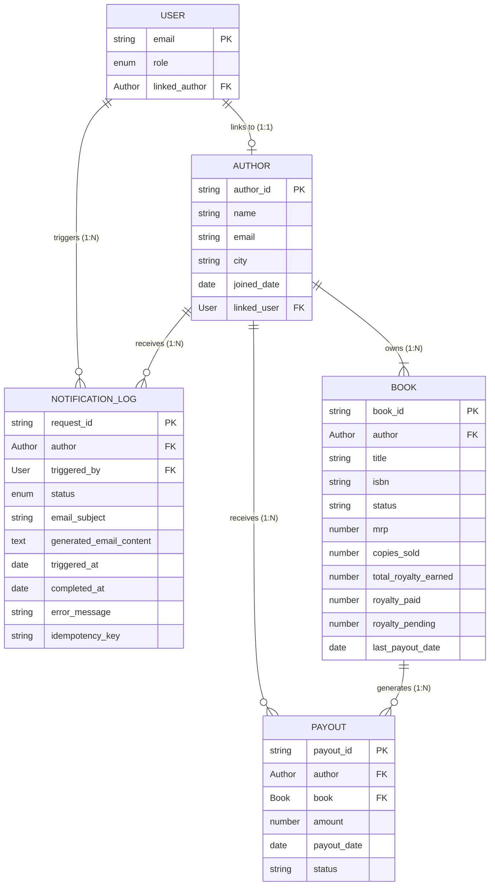

# BookLeaf Bubble Database Schema Design

This document specifies the exact relational database structure for the BookLeaf Application in Bubble.io, designed strictly around the verified dataset (`bookleaf_sample_data.json`).

---

## 1. Architectural Principles & Relational Design

1. **Normalized 1-to-Many Relationships**:
   - One `Author` has many `Books` (1:N).
   - One `Author` has many `NotificationLogs` (1:N).
   - One `Author` has many `Payouts` (1:N).
   - One `User` is linked to exactly one `Author` (1:1) if their role is `AUTHOR`.
   - Author metadata (such as `phone`, `city`, `joined_date`) is stored exclusively on the `Author` record to eliminate data anomalies and duplicate writes across books.

2. **Strict Typing for Financial Integrity**:
   - Numeric values (`total_copies_sold`, `mrp`, `author_royalty_per_copy`, `total_royalty_earned`, `royalty_paid`, `royalty_pending`) are strictly typed as **number**, never text. This prevents calculation errors and enables native Bubble mathematical operators (`:sum`, `:minus`, `:format as currency`).

3. **Temporal Integrity**:
   - Dates (`publication_date`, `last_royalty_payout_date`, `triggered_at`, `completed_at`) are strictly typed as **date**, allowing reliable relative calculations (e.g. `+(days): -90` for overdue payout checks). Null dates represent books awaiting inaugural publication or payout and are treated safely.

4. **Data Privacy & Tenancy Segregation**:
   - Relationships are bidirectional or indexed so that Bubble Privacy Rules can evaluate access rights without client-side data leakage.

---

## 2. Option Sets (Bubble Global Enums)

In Bubble, navigate to **Data** $\rightarrow$ **Option sets** and define the following:

### 2.1 `UserRole`
- **Options**:
  - `ADMIN` (Display: "Operations Admin")
  - `AUTHOR` (Display: "Author")
- **Attributes**:
  - `default_redirect_page` (text) $\rightarrow$ `admin-dashboard` or `author-dashboard`

### 2.2 `NotificationStatus`
- **Options**:
  - `PROCESSING` (Display: "Processing")
  - `SUCCESS` (Display: "Success")
  - `FAILED` (Display: "Failed")
- **Attributes**:
  - `badge_color` (text) $\rightarrow$ `#3B82F6` (blue), `#10B981` (green), `#EF4444` (red)

### 2.3 `RoyaltyStatusBadge`
- **Options**:
  - `GREEN` (Display: "All Paid")
  - `YELLOW` (Display: "Pending (In Cycle)")
  - `RED` (Display: "Overdue / Action Needed")
- **Attributes**:
  - `hex_code` (text) $\rightarrow$ `#16A34A` (green), `#CA8A04` (yellow), `#DC2626` (red)
  - `bg_color` (text) $\rightarrow$ `#DCFCE7`, `#FEF9C3`, `#FEE2E2`

---

## 3. Data Types & Field Definitions

### 3.1 Data Type: `User` (Bubble Built-In)
Represents authentication and credentials.

| Field Name | Bubble Data Type | Default | Description |
| :--- | :--- | :--- | :--- |
| `email` | `text` (built-in) | — | User's unique login email |
| `name` | `text` | — | User's full name |
| `role` | `UserRole` (Option set) | `AUTHOR` | System role for RBAC (`AUTHOR` or `ADMIN`) |
| `linked_author` | `Author` | — | Pointer to the corresponding Author record |

---

### 3.2 Data Type: `Author`
Represents the author profile and business entity.

| Field Name | Bubble Data Type | Default | Description |
| :--- | :--- | :--- | :--- |
| `author_id` | `text` | — | External business ID (e.g. `"AUTH001"`) |
| `name` | `text` | — | Full author name |
| `email` | `text` | — | Contact email |
| `phone` | `text` | — | Contact telephone number |
| `city` | `text` | — | Residential city (used for admin filtering) |
| `joined_date` | `date` | — | Onboarding date at BookLeaf |
| `linked_user` | `User` | — | 1:1 relationship back to the auth User |
| `books` | `List of Books` | `[]` | List of books authored |
| `payout_status_cached`| `RoyaltyStatusBadge` | `YELLOW` | Cached overall royalty badge for quick admin table rendering |

---

### 3.3 Data Type: `Book`
Represents an individual book title and its royalty performance.

| Field Name | Bubble Data Type | Default | Description |
| :--- | :--- | :--- | :--- |
| `book_id` | `text` | — | External catalog identifier (e.g. `"BK001"`) |
| `author` | `Author` | — | Foreign key relationship to parent Author |
| `author_id_str` | `text` | — | Denormalized author ID string for fast API matching |
| `title` | `text` | — | Book title |
| `isbn` | `text` | — | Assigned ISBN |
| `genre` | `text` | — | Book genre/category |
| `publication_date` | `date` | — | Release date (null for In Production) |
| `status` | `text` | `"Published & Live"` | Publishing lifecycle stage |
| `mrp` | `number` | — | Maximum retail price in INR |
| `author_royalty_per_copy`| `number`| — | Agreed contract royalty rate in INR |
| `total_copies_sold`| `number` | `0` | Cumulative units sold |
| `total_royalty_earned` | `number` | `0` | Total royalty accrued (`copies_sold * royalty_per_copy`) |
| `royalty_paid` | `number` | `0` | Total royalty disbursed to author |
| `royalty_pending` | `number` | `0` | Outstanding royalty due |
| `last_royalty_payout_date` | `date` | — | Date of most recent payout disbursement |
| `print_partner` | `text` | — | Fulfilment printing house |
| `available_on_raw` | `text` | — | Comma-separated platform availability list |

---

### 3.4 Data Type: `Payout`
Represents actual payout disbursements verified in the dataset.

| Field Name | Bubble Data Type | Default | Description |
| :--- | :--- | :--- | :--- |
| `payout_id` | `text` | — | Unique payout identifier (e.g. `"PAY001"`) |
| `author` | `Author` | — | Associated Author |
| `book` | `Book` | — | Associated Book title |
| `amount` | `number` | `0` | Disbursed amount in INR |
| `payout_date` | `date` | — | Date transfer executed |
| `status` | `text` | `"PAID"` | Payout status (`PAID`, `PENDING`) |
| `note` | `text` | — | Reference/cycle note (e.g. `"Quarterly Disbursement"`) |

---

### 3.5 Data Type: `NotificationLog`
Tracks every royalty summary request triggered via Bubble to n8n.

| Field Name | Bubble Data Type | Default | Description |
| :--- | :--- | :--- | :--- |
| `request_id` | `text` | — | Unique UUID for idempotency and tracking |
| `author` | `Author` | — | Target author |
| `triggered_by` | `User` | — | Admin user who initiated the request |
| `status` | `NotificationStatus` | `PROCESSING` | Lifecycle: `PROCESSING`, `SUCCESS`, `FAILED` |
| `email_subject` | `text` | — | AI-generated email subject line |
| `generated_email_content`| `text` | — | Formatted AI response content |
| `triggered_at` | `date` | `Current date/time`| Request initiation timestamp |
| `completed_at` | `date` | — | Timestamp of callback from n8n |
| `error_message` | `text` | — | Failure reason if execution failed |
| `idempotency_key`| `text` | — | Composite key: `author_id + "_" + date` |

---

## 4. Entity-Relationship Diagram (ERD)

---

## 5. Status Calculation Logic (Green / Yellow / Red)

The royalty status for any author or book is determined deterministically by these business rules:

1. **GREEN (All Paid)**:
   - Condition: `royalty_pending == 0`.
   - Meaning: All earned royalties have been disbursed. No balance is pending.
   - Example: Farhan Sheikh (`AUTH008`, pending = ₹0).

2. **RED (Overdue / Requires Action)**:
   - Condition: `royalty_pending > 0` AND:
     - `last_royalty_payout_date < Current date/time +(days): -90` (more than 90 days since last payout); OR
     - `last_royalty_payout_date is empty` AND `publication_date < Current date/time +(days): -90` (published > 90 days ago with zero payouts).
   - Meaning: The author has pending royalties that have exceeded the standard quarterly payout window.
   - Example: Vikram Joshi (`BK006 - Debugging Life`, last payout 2025-08-20 is > 90 days old).

3. **YELLOW (Pending within Normal Cycle)**:
   - Condition: `royalty_pending > 0` AND does NOT meet RED conditions.
   - Includes:
     - Recent publications (e.g. `Howrah Nights`, published Jan 2025).
     - Sub-threshold rollover (e.g. Kavita Deshmukh, pending = ₹850 < ₹1,000 threshold).
     - Standard active quarterly cycle (e.g. Priya Sharma, last payout within 90 days).

