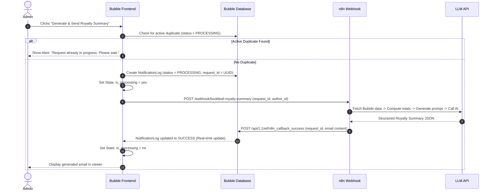

# BookLeaf Bubble Workflows Specification

This document details every visual and backend workflow required for the Bubble application, including API Connector setup, single and bulk trigger orchestrations, duplicate suppression, and webhook callbacks.

---

## 1. Bubble API Connector Configuration (Bubble $\rightarrow$ n8n)

To enable Bubble to communicate with n8n, install the official **API Connector** plugin in Bubble:
1. Go to **Plugins** $\rightarrow$ Click **Add plugins**.
2. Search for `API Connector` by Bubble and click **Install**.
3. Click **Add another API**.
   - API Name: `n8n Operations Gateway`
   - Authentication: `None or self-handled` (We pass custom authentication headers)

### 1.1 API Call: `Trigger Royalty Summary`
- Name: `TriggerRoyaltySummary`
- Use as: `Action`
- Data type: `JSON`
- HTTP Method: `POST`
- URL: `https://[YOUR_N8N_INSTANCE]/webhook/bookleaf-royalty-summary`
- Headers:
  - Key: `Content-Type` | Value: `application/json`
  - Key: `X-Webhook-Secret` | Value: `[YOUR_SHARED_SECRET]` (Private: check `[x]`)
- Body type: `JSON`
- Body JSON Template:
```json
{
  "request_id": "<request_id>",
  "author_id": "<author_id>",
  "author_name": "<author_name>",
  "author_email": "<author_email>",
  "triggered_by": "<triggered_by>",
  "triggered_at": "<triggered_at>"
}
```
- Parameters (enter sample values to initialize call):
  - `request_id`: `REQ-TEST-001` (Uncheck `[ ] Private`)
  - `author_id`: `AUTH001` (Uncheck `[ ] Private`)
  - `author_name`: `Priya Sharma` (Uncheck `[ ] Private`)
  - `author_email`: `priya.sharma@email.com` (Uncheck `[ ] Private`)
  - `triggered_by`: `admin@bookleaf.com` (Uncheck `[ ] Private`)
  - `triggered_at`: `2026-11-03T08:00:00Z` (Uncheck `[ ] Private`)
- Click **Initialize call** and save the data types.

---

## 2. Frontend Workflow: Single Author Summary Trigger

Triggered when the Admin clicks `Btn_TriggerSingleSummary` inside `Popup_AuthorDetail`.



### Exact Step-by-Step Workflow in Bubble:
- **Event**: `When Button Generate & Send Royalty Summary is clicked`

#### Step 1: Idempotency & Duplicate Check
- Action: `Element Actions` $\rightarrow$ `Show message in Alert`
  - Condition: `Only when Search for NotificationLogs(author = Parent group's Author, status = 'PROCESSING'):count > 0`
  - Message: `"A royalty summary request is already being processed for this author. Please wait for completion."`
  - Action terminates if condition is met.

#### Step 2: Set Loading State
- Action: `Element Actions` $\rightarrow$ `Set state`
  - Element: `Popup_AuthorDetail`
  - Custom State: `is_processing`
  - Value: `'yes'`

#### Step 3: Create NotificationLog Record
- Action: `Data` $\rightarrow$ `Create a new thing...`
  - Type: `NotificationLog`
  - Fields:
    - `request_id` = `Calculate formula: Generate random string (12 chars)` + `_` + `Current date/time:extract Unix timestamp`
    - `author` = `Parent group's Author`
    - `triggered_by` = `Current User`
    - `status` = `'PROCESSING'`
    - `triggered_at` = `Current date/time`
    - `idempotency_key` = `Parent group's Author's author_id` + `_` + `Current date/time:formatted as yyyy-MM-dd-HH`

#### Step 4: Call n8n Webhook via API Connector
- Action: `Plugins` $\rightarrow$ `n8n Operations Gateway - TriggerRoyaltySummary`
  - `request_id` = `Result of step 3's request_id`
  - `author_id` = `Parent group's Author's author_id`
  - `author_name` = `Parent group's Author's name`
  - `author_email` = `Parent group's Author's email`
  - `triggered_by` = `Current User's email`
  - `triggered_at` = `Current date/time:formatted as ISO 8601`

#### Step 5: Save Active Request Reference
- Action: `Element Actions` $\rightarrow$ `Set state`
  - Element: `Popup_AuthorDetail`
  - Custom State: `active_log`
  - Value: `Result of step 3`

---

## 3. Frontend Workflow: Bulk Trigger for All Pending Authors

Triggered when the Admin clicks `Btn_BulkTrigger` on the main admin dashboard.

### Exact Step-by-Step Workflow:
- **Event**: `When Button Bulk Trigger is clicked`

#### Step 1: Confirmation Prompt
- Action: `Element Actions` $\rightarrow$ `Show Alert`
  - Alert: `"Initiating royalty summaries for all authors with pending balances > ₹0..."`

#### Step 2: Trigger Backend Workflow on List
- Action: `Custom Events` $\rightarrow$ `Schedule API Workflow on a list`
  - API Workflow: `trigger_single_author_n8n`
  - Type of list: `Author`
  - List to run on:
    ```
    Search for Authors:filtered(This Author's books's royalty_pending:sum > 0)
    ```
    *(Note: Filters out authors like Farhan Sheikh whose pending royalty is ₹0).*
  - Scheduled date: `Current date/time`
  - Interval (seconds): `2` (Stagger each request by 2 seconds to respect LLM rate limits)

---

## 4. Backend Workflows (API Workflows) Setup

In Bubble, enable Backend Workflows:
1. Go to **Settings** $\rightarrow$ **API**.
2. Check `[x] Enable Workflow API and backend workflows`.
3. Check `[x] Enable Data API` for `Author`, `Book`, `Payout`, and `NotificationLog`.
4. In the page selector dropdown at top left, navigate to **Backend Workflows**.

---

### 4.1 Backend Workflow: `n8n_callback_success`
This endpoint is called by n8n when the AI generation succeeds.

- **Settings**:
  - Endpoint name: `n8n_callback_success`
  - Exposed as a public API workflow: `[x] Checked`
  - This workflow can be run without authentication: `[x] Checked` *(Validated via secret parameter)*
- **Parameters**:
  - `request_id` (Type: `text`)
  - `auth_secret` (Type: `text`)
  - `email_subject` (Type: `text`)
  - `email_body` (Type: `text`)
  - `total_earned` (Type: `number`)
  - `total_paid` (Type: `number`)
  - `total_pending` (Type: `number`)

#### Actions:
1. **Security Guard**:
   - Condition on all steps: `Only when auth_secret is [YOUR_SHARED_SECRET]`
2. **Update NotificationLog**:
   - Action: `Data` $\rightarrow$ `Make changes to a thing...`
   - Thing to change: `Search for NotificationLogs(request_id = request_id):first item`
   - Fields:
     - `status` = `'SUCCESS'`
     - `email_subject` = `email_subject`
     - `generated_email_content` = `email_body`
     - `completed_at` = `Current date/time`
3. **Return HTTP 200 Response**:
   - Action: `Data (API)` $\rightarrow$ `Return data from API`
   - Key: `status` | Value: `"acknowledged"`

---

### 4.2 Backend Workflow: `n8n_callback_failure`
This endpoint is called by n8n if any node (Bubble API, data validation, AI model, or network) fails.

- **Settings**:
  - Endpoint name: `n8n_callback_failure`
  - Exposed as a public API workflow: `[x] Checked`
- **Parameters**:
  - `request_id` (Type: `text`)
  - `auth_secret` (Type: `text`)
  - `error_message` (Type: `text`)

#### Actions:
1. **Update NotificationLog to FAILED**:
   - Action: `Data` $\rightarrow$ `Make changes to a thing...`
   - Thing to change: `Search for NotificationLogs(request_id = request_id):first item`
   - Fields:
     - `status` = `'FAILED'`
     - `error_message` = `error_message`
     - `completed_at` = `Current date/time`
2. **Return Response**:
   - Return status: `"failure_logged"`

