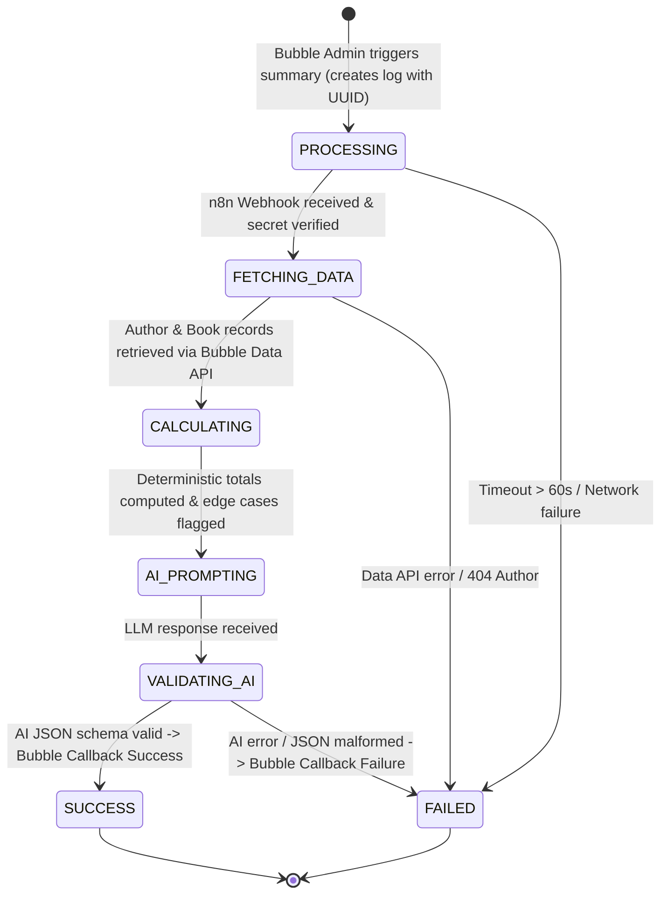

# Bubble $\leftrightarrow$ n8n Integration Contract & Communication Protocols

This document defines the strict API contract, authentication handshakes, payload schemas, and lifecycle state machines governing communication between the Bubble.io application and the n8n automation workflow.

---

## 1. Architecture & State Transition Diagram



---

## 2. Channel 1: Bubble $\rightarrow$ n8n Webhook Trigger

Invoked by Bubble's API Connector when an individual or bulk summary is triggered.

### 2.1 Request Details
- **Method**: `POST`
- **URL**: `https://[N8N_HOST]/webhook/bookleaf-royalty-summary`
- **Headers**:
  ```http
  Content-Type: application/json
  X-Webhook-Secret: bookleaf_secure_webhook_secret_2026
  ```

### 2.2 Request Body Schema
```json
{
  "$schema": "http://json-schema.org/draft-07/schema#",
  "title": "BubbleWebhookPayload",
  "type": "object",
  "required": ["request_id", "author_id", "triggered_by", "triggered_at"],
  "properties": {
    "request_id": {
      "type": "string",
      "description": "Unique UUID generated by Bubble for tracking and idempotency",
      "example": "REQ-AUTH001-1772600000"
    },
    "author_id": {
      "type": "string",
      "description": "BookLeaf author ID",
      "example": "AUTH001"
    },
    "author_name": {
      "type": "string",
      "example": "Priya Sharma"
    },
    "author_email": {
      "type": "string",
      "format": "email",
      "example": "priya.sharma@email.com"
    },
    "triggered_by": {
      "type": "string",
      "description": "Email or ID of admin initiating the run",
      "example": "admin@bookleaf.com"
    },
    "triggered_at": {
      "type": "string",
      "format": "date-time",
      "example": "2026-11-03T08:30:00.000Z"
    }
  }
}
```

### 2.3 Expected Responses from n8n
- **HTTP 200 OK**:
  ```json
  {
    "status": "ACCEPTED",
    "request_id": "REQ-AUTH001-1772600000",
    "message": "Workflow execution scheduled successfully"
  }
  ```
- **HTTP 401 Unauthorized**:
  ```json
  {
    "status": "REJECTED",
    "error": "Invalid or missing X-Webhook-Secret header"
  }
  ```
- **HTTP 400 Bad Request**:
  ```json
  {
    "status": "REJECTED",
    "error": "Missing required fields in payload (request_id or author_id)"
  }
  ```

---

## 3. Channel 2: n8n $\rightarrow$ Bubble Data API (Data Retrieval)

Rather than accepting potentially stale or manipulated financial data in the webhook payload, n8n treats Bubble as the authoritative source of truth and fetches current records using Bubble's Data API.

### 3.1 Fetch Author Record
- **Method**: `GET`
- **URL**: `https://[BUBBLE_APP].bubbleapps.io/version-test/api/1.1/obj/author?constraints=[{"key":"author_id","constraint_type":"equals","value":"AUTH001"}]`
- **Headers**:
  ```http
  Authorization: Bearer [BUBBLE_API_TOKEN]
  Content-Type: application/json
  ```
- **Response Format**:
  ```json
  {
    "response": {
      "results": [
        {
          "_id": "1678888000000x123",
          "author_id": "AUTH001",
          "name": "Priya Sharma",
          "email": "priya.sharma@email.com",
          "city": "Mumbai",
          "phone": "+91-98765-43210",
          "joined_date": "2023-03-15T00:00:00.000Z"
        }
      ],
      "remaining": 0,
      "count": 1
    }
  }
  ```

### 3.2 Fetch Author's Books
- **Method**: `GET`
- **URL**: `https://[BUBBLE_APP].bubbleapps.io/version-test/api/1.1/obj/book?constraints=[{"key":"author_id_str","constraint_type":"equals","value":"AUTH001"}]`
- **Headers**:
  ```http
  Authorization: Bearer [BUBBLE_API_TOKEN]
  Content-Type: application/json
  ```
- **Response Format**:
  ```json
  {
    "response": {
      "results": [
        {
          "_id": "book_bk001_id",
          "book_id": "BK001",
          "title": "Whispers of the Ganges",
          "isbn": "978-93-5XXXX-01-1",
          "genre": "Literary Fiction",
          "publication_date": "2023-06-20T00:00:00.000Z",
          "status": "Published & Live",
          "mrp": 399,
          "author_royalty_per_copy": 35,
          "total_copies_sold": 342,
          "total_royalty_earned": 11970,
          "royalty_paid": 8400,
          "royalty_pending": 3570,
          "last_royalty_payout_date": "2025-10-15T00:00:00.000Z",
          "available_on_raw": "Amazon India, Flipkart, BookLeaf Store"
        }
      ],
      "count": 2
    }
  }
  ```

---

## 4. Channel 3: n8n $\rightarrow$ Bubble Callback (Result Handshake)

When n8n finishes orchestrating the AI response (or catches an exception), it triggers Bubble's exposed Backend Workflows.

### 4.1 Success Callback (`n8n_callback_success`)
- **Method**: `POST`
- **URL**: `https://[BUBBLE_APP].bubbleapps.io/version-test/api/1.1/wf/n8n_callback_success`
- **Headers**:
  ```http
  Content-Type: application/json
  ```
- **Body Schema**:
  ```json
  {
    "request_id": "REQ-AUTH001-1772600000",
    "auth_secret": "bookleaf_secure_webhook_secret_2026",
    "email_subject": "Your BookLeaf Royalty Summary — Q4 2025 Updates",
    "email_body": "Dear Priya Sharma,\n\nWe are pleased to provide your consolidated royalty breakdown...",
    "total_earned": 19908,
    "total_paid": 16338,
    "total_pending": 3570
  }
  ```
- **Bubble Action**:
  - Updates `NotificationLog` matching `request_id`:
    - `status` $\rightarrow$ `SUCCESS`
    - `email_subject` $\rightarrow$ payload `email_subject`
    - `generated_email_content` $\rightarrow$ payload `email_body`
    - `completed_at` $\rightarrow$ `Current date/time`

---

### 4.2 Failure Callback (`n8n_callback_failure`)
- **Method**: `POST`
- **URL**: `https://[BUBBLE_APP].bubbleapps.io/version-test/api/1.1/wf/n8n_callback_failure`
- **Headers**:
  ```http
  Content-Type: application/json
  ```
- **Body Schema**:
  ```json
  {
    "request_id": "REQ-AUTH001-1772600000",
    "auth_secret": "bookleaf_secure_webhook_secret_2026",
    "error_message": "LLM API Rate Limit Exceeded (HTTP 429). Attempted 3 retries."
  }
  ```
- **Bubble Action**:
  - Updates `NotificationLog` matching `request_id`:
    - `status` $\rightarrow$ `FAILED`
    - `error_message` $\rightarrow$ payload `error_message`
    - `completed_at` $\rightarrow$ `Current date/time`

---

## 5. Security & Idempotency Rules

1. **Shared Secret Verification**:
   - Both the incoming webhook to n8n and the callback endpoints into Bubble verify `X-Webhook-Secret` or `auth_secret`. Unauthorized requests are rejected immediately.
2. **Never Stale in 'Processing'**:
   - The n8n workflow includes a global `Error Trigger` node. If any unhandled exception occurs, the failure branch executes immediately, ensuring the Bubble UI never hangs indefinitely.
3. **Idempotency Window**:
   - Bubble checks if a notification for the same author with status `PROCESSING` was created within the last 15 minutes. If found, a duplicate trigger is rejected at the UI layer.

