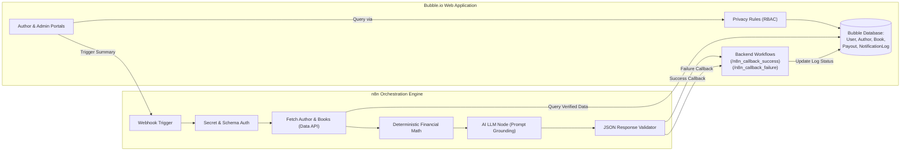

# BookLeaf Publishing — Author Royalty Dashboard & Automated Notification System

An enterprise-grade hybrid application built with **Bubble.io**, **n8n automation**, and **Large Language Models (LLMs)** for **BookLeaf Publishing**. 

This system provides a responsive, role-based portal for authors to track catalog royalties, sales volumes, and disbursement cycles, alongside an operations management dashboard for BookLeaf's publishing team to orchestrate AI-generated royalty summaries at publishing scale.

---

## 🌟 Key Capabilities

### 1. Dual-Persona Architecture
- **Author Portal**:
  - Secure email/password authentication with automatic role redirection.
  - Consolidated financial overview: Total Royalty Earned, Disbursed (Paid), and Outstanding (Pending).
  - Book-by-book catalog view with units sold, ISBN, genre, MRP, and distribution channels.
  - Three-state visual royalty health indicators:
    - **GREEN**: All royalties settled (₹0 pending).
    - **YELLOW**: Outstanding balance within normal quarterly cycle (or sub-₹1,000 rollover).
    - **RED**: Payout overdue (> 90 days since last disbursement).
  - Sub-threshold policy notice: Balance < ₹1,000 clearly explained as rolling over without lapsing.
- **Operations Admin Portal**:
  - Global overview of all 10 authors and 18 books with search and multi-criteria filters (City, Payout Status).
  - In-depth author detail inspection showing profiles, catalogs, and payout histories.
  - **Single Trigger Action**: "Generate & Send Royalty Summary" invoking an authenticated n8n webhook.
  - **Bulk Trigger Action**: "Generate Summaries for All Authors with Pending Royalties" with automated pacing.
  - Audit log table tracking request IDs, processing states, error traces, and full email contents.

### 2. Deterministic AI Grounding
- **Zero Hallucination Arithmetic**: Cumulative units sold, royalties earned, paid, and pending are computed deterministically via JavaScript before the LLM prompt is assembled.
- **Policy Compliance**: Prompts strictly ground responses in BookLeaf's Knowledge Base:
  - 80/20 royalty split (80% net profit to author).
  - Quarterly disbursement cycle (within 45 days of quarter close).
  - ₹1,000 minimum threshold rollover policy.
  - Separate, milestone-based acknowledgement for books in production (e.g. Typesetting, Cover Design).

### 3. Enterprise Security & Resilience
- **Database-Level Privacy Rules**: Access control enforced strictly on Bubble's database servers. Authors are physically prevented from retrieving other authors' books or financial records.
- **Asynchronous Webhook & Callback Handshake**: Long-running AI operations run asynchronously in n8n, eliminating browser timeouts and keeping Bubble responsive.
- **Idempotency Guard**: Unique request UUIDs and active-request checks prevent duplicate triggers.
- **Fail-Safe Transitions**: Unhandled exceptions trigger automated failure callbacks, ensuring requests are never left stuck in `PROCESSING`.

---

## 📁 Repository Structure

```
bookleaf-assignment-2/
│
├── README.md                          # Main project documentation (this file)
├── ARCHITECTURE.md                    # End-to-end architecture & Mermaid diagrams
├── BUBBLE_DATABASE_SCHEMA.md          # Complete relational schema inside Bubble
├── BUBBLE_IMPLEMENTATION_GUIDE.md     # Visual editor click-by-click design guide
├── BUBBLE_WORKFLOWS.md                # Frontend & backend workflow configurations
├── PRIVACY_RULES.md                   # Database-level access control specifications
├── INTEGRATION_CONTRACT.md            # Webhook & callback communication contract
├── AI_PROMPT.md                       # LLM prompt engineering & policy grounding
├── TESTING_CHECKLIST.md               # QA matrix & test verification statuses
│
├── n8n/
│   ├── bookleaf-royalty-summary.json  # Importable 11-node n8n workflow export
│   ├── workflow-setup.md              # Setup, credential configuration & test guide
│   ├── sample-payloads.json           # Test payloads for all author scenarios
│   └── simulate-automation.js         # Standalone local execution test harness
│
├── data/
│   ├── inspected-source-schema.md     # Verified analysis of bookleaf_sample_data.json
│   ├── import-instructions.md         # Guide for loading CSVs into Bubble App Data
│   ├── seed-bubble-api.js             # Optional programmatic Data API seed script
│   ├── authors.csv                    # Clean CSV of all 10 authors
│   ├── books.csv                      # Clean CSV of all 18 books
│   ├── users.csv                      # Clean CSV of test user credentials
│   └── payouts.csv                    # Clean CSV of verified payout records
│
├── tests/
│   └── test-suite.js                  # Automated test suite validating data & logic
│
└── docs/
    ├── system-architecture.md         # Component breakdown & architectural boundaries
    ├── learning-log.md                # Engineering translations (React/SQL vs Bubble/n8n)
    ├── submission-checklist.md        # Deliverables review & founder interview prep
    └── screen-recording-script.md     # 3–5 minute walkthrough narration guide
```

---

## 🏗️ System Architecture



---

## 🗄️ Database Schema Design

| Data Type | Key Fields | Relationships | Cardinality |
| :--- | :--- | :--- | :--- |
| **`User`** | `email`, `name`, `role` (`AUTHOR` / `ADMIN`), `linked_author` | Links to `Author` | 1 : 1 (for authors) |
| **`Author`** | `author_id`, `name`, `email`, `phone`, `city`, `joined_date` | Has many `Books`, `Payouts`, `NotificationLogs` | 1 : N |
| **`Book`** | `book_id`, `title`, `isbn`, `genre`, `status`, `mrp`, `copies_sold`, `earned`, `paid`, `pending`, `last_payout_date` | Belongs to `Author` | N : 1 |
| **`Payout`** | `payout_id`, `amount`, `payout_date`, `status`, `note` | Belongs to `Author` and `Book` | N : 1 |
| **`NotificationLog`** | `request_id`, `status` (`PROCESSING`, `SUCCESS`, `FAILED`), `email_subject`, `generated_email_content`, `triggered_at`, `completed_at` | Belongs to `Author`, triggered by `User` | N : 1 |

For detailed field types and option sets, refer to [`BUBBLE_DATABASE_SCHEMA.md`](./BUBBLE_DATABASE_SCHEMA.md).

---

## 🔒 Privacy Rules (Database-Level Access Control)

In compliance with assignment requirements, security is enforced strictly at the database level:
- **Authors**:
  - Can only view their own `Author` record (`Current User's linked_author is This Author`).
  - Can only query their own `Books` (`Current User's linked_author is This Book's author`).
  - Can only see their personal `Payout` records.
  - Cannot access other authors' profiles or notification logs.
- **Operations Admins**:
  - Full access to view, search, and update all records across all tables.

For exact configuration clicks, see [`PRIVACY_RULES.md`](./PRIVACY_RULES.md).

---

## ⚡ Bubble $\leftrightarrow$ n8n Integration Protocol

### 1. Webhook Trigger (Bubble $\rightarrow$ n8n)
- **Method**: `POST`
- **Live Application URL**: https://bookleaf-royalty-ashirwad.bubbleapps.io/version-test/
- **Bubble Editor URL**: https://bubble.io/page?id=bookleaf-royalty-ashirwad
- **Headers**: `X-Webhook-Secret: bookleaf_secure_webhook_secret_2026`
- **Payload**:
  ```json
  {
    "request_id": "REQ-AUTH001-1772600000",
    "author_id": "AUTH001",
    "author_name": "Priya Sharma",
    "author_email": "priya.sharma@email.com",
    "triggered_by": "admin@bookleaf.com",
    "triggered_at": "2026-11-03T08:30:00.000Z"
  }
  ```

### 2. Callback Handshake (n8n $\rightarrow$ Bubble)
- **Success Endpoint**: `POST /api/1.1/wf/n8n_callback_success`
  - Updates `NotificationLog` status to `SUCCESS`, populates `email_subject`, `generated_email_content`, and sets `completed_at`.
- **Failure Endpoint**: `POST /api/1.1/wf/n8n_callback_failure`
  - Updates `NotificationLog` status to `FAILED` and logs `error_message`.

For the full contract, see [`INTEGRATION_CONTRACT.md`](./INTEGRATION_CONTRACT.md).

---

## 🚀 Quick Setup & Local Execution

### 1. Run Automated Verification Tests
Validate dataset integrity, math aggregations, and workflow schemas:
```bash
node bookleaf-assignment-2/tests/test-suite.js
```

### 2. Test n8n Automation Locally (Zero Setup)
Run the local simulation harness against any author in the dataset:
```bash
# Test Standard Author (Priya Sharma - AUTH001)
node bookleaf-assignment-2/n8n/simulate-automation.js AUTH001

# Test Sub-₹1,000 Rollover Author (Kavita Deshmukh - AUTH009)
node bookleaf-assignment-2/n8n/simulate-automation.js AUTH009

# Test All-Paid Author (Farhan Sheikh - AUTH008)
node bookleaf-assignment-2/n8n/simulate-automation.js AUTH008

# Test In-Production Book (Sneha Kulkarni - AUTH007)
node bookleaf-assignment-2/n8n/simulate-automation.js AUTH007
```

### 3. Deploying n8n Workflow
1. Start n8n locally via `npx n8n` (or log in to n8n Cloud).
2. Go to **Workflows** $\rightarrow$ **Import from File...** $\rightarrow$ Select `n8n/bookleaf-royalty-summary.json`.
3. Set your environment variables (`WEBHOOK_SECRET`, `BUBBLE_BASE_URL`, `OPENAI_API_KEY`).
4. Activate the workflow!

### 4. Importing Data into Bubble
Follow [`data/import-instructions.md`](./data/import-instructions.md) to upload the 4 pre-generated CSVs (`authors.csv`, `books.csv`, `users.csv`, `payouts.csv`) directly into Bubble's App Data tab.

---

## ⚠️ Known Limitations & Future Evolutions

1. **Email Delivery**: The current workflow generates and validates the complete email body and saves it to Bubble's audit log. In a live production deployment, an additional n8n node (e.g. SendGrid or Postmark) can be enabled to send the message directly to the author's inbox.
2. **Dynamic Payout Thresholds**: The ₹1,000 threshold is currently defined as a global rule. In future iterations, this can be parameterized per author contract or currency.
3. **Multi-Currency Support**: Currently modeled in Indian Rupees (INR). For authors receiving international sales from Amazon US/UK, exchange rate conversion nodes can be added to the n8n pipeline.

