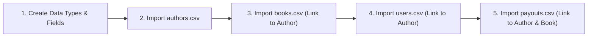

# BookLeaf Data Import & Seeding Instructions

This guide provides step-by-step instructions for loading the 10 authors, 18 books, and initial payout disbursements into your Bubble.io application database.

---

## 1. Import Files Provided

The following sanitized, ready-to-upload CSV files are located in `bookleaf-assignment-2/data/`:

| File Name | Target Bubble Data Type | Total Records | Description |
| :--- | :--- | :--- | :--- |
| `authors.csv` | `Author` | 10 | Author profiles, contact details, cities, join dates |
| `books.csv` | `Book` | 18 | Titles, ISBNs, sales, royalties, payout dates, channels |
| `users.csv` | `User` | 11 | 1 Admin + 10 Authors (matching credentials) |
| `payouts.csv` | `Payout` | 12 | 12 verified historical payout records derived from books |

---

## 2. Order of Operations in Bubble

In Bubble's relational database, child records (e.g. `Book`) reference parent records (e.g. `Author`). Therefore, imports must occur in this exact order:



---

## 3. Step-by-Step Bubble GUI Import Guide

### Step 1: Create Data Types First
Before uploading CSVs, navigate to **Data** $\rightarrow$ **Data types** in the Bubble editor and create the types and fields detailed in `BUBBLE_DATABASE_SCHEMA.md`:
- Data Type `Author`
- Data Type `Book`
- Data Type `Payout`
- Data Type `NotificationLog`
- Modify built-in `User`

---

### Step 2: Upload `authors.csv`
1. In Bubble, go to **Data** $\rightarrow$ **App data**.
2. Select **All Authors** from the left sidebar.
3. Click **Upload** (top right of the table).
4. Select `bookleaf-assignment-2/data/authors.csv`.
5. In the Column Mapping dialog:
   - `author_id` $\rightarrow$ Map to `author_id` (text)
   - `name` $\rightarrow$ Map to `name` (text)
   - `email` $\rightarrow$ Map to `email` (text)
   - `phone` $\rightarrow$ Map to `phone` (text)
   - `city` $\rightarrow$ Map to `city` (text)
   - `joined_date` $\rightarrow$ Map to `joined_date` (date)
6. Click **Upload data**.
7. Verify all 10 records appear with their respective cities and IDs.

---

### Step 3: Upload `books.csv`
1. In Bubble, go to **Data** $\rightarrow$ **App data**.
2. Select **All Books** from the left sidebar.
3. Click **Upload**.
4. Select `bookleaf-assignment-2/data/books.csv`.
5. In the Column Mapping dialog:
   - `book_id` $\rightarrow$ `book_id` (text)
   - `title` $\rightarrow$ `title` (text)
   - `isbn` $\rightarrow$ `isbn` (text)
   - `genre` $\rightarrow$ `genre` (text)
   - `publication_date` $\rightarrow$ `publication_date` (date)
   - `status` $\rightarrow$ `status` (text)
   - `mrp` $\rightarrow$ `mrp` (number)
   - `author_royalty_per_copy` $\rightarrow$ `author_royalty_per_copy` (number)
   - `total_copies_sold` $\rightarrow$ `total_copies_sold` (number)
   - `total_royalty_earned` $\rightarrow$ `total_royalty_earned` (number)
   - `royalty_paid` $\rightarrow$ `royalty_paid` (number)
   - `royalty_pending` $\rightarrow$ `royalty_pending` (number)
   - `last_royalty_payout_date` $\rightarrow$ `last_royalty_payout_date` (date)
   - `print_partner` $\rightarrow$ `print_partner` (text)
   - `available_on` $\rightarrow$ `available_on_raw` (text) or list of texts
6. **Linking Author to Book**:
   - In Bubble's CSV upload tool, for the field `author` (type `Author`), choose "Map to a field in another type" $\rightarrow$ Match on `author_id` $\rightarrow$ Column `author_id`.
   - Bubble automatically connects each Book to its Author!
7. Click **Upload data**. Confirm 18 books are loaded.

---

### Step 4: Upload `users.csv`
1. Go to **Data** $\rightarrow$ **App data** $\rightarrow$ **All Users**.
2. Click **Upload** and select `bookleaf-assignment-2/data/users.csv`.
3. Map:
   - `email` $\rightarrow$ `email` (text)
   - `name` $\rightarrow$ `name` (text)
   - `role` $\rightarrow$ `role` (UserRole Option Set or text `"ADMIN"` / `"AUTHOR"`)
   - `author_id` $\rightarrow$ Link to `Author` by matching `author_id`.
4. Click **Upload data**.
5. *Note on Passwords*: In Bubble, native passwords cannot be imported via plain CSV for security reasons. For local testing, use Bubble's built-in **"Run as"** feature (under App Data $\rightarrow$ click "Run as" next to any user) or use a simple setup workflow that sets passwords to `author123` / `admin123`.

---

### Step 5: Upload `payouts.csv`
1. Go to **Data** $\rightarrow$ **App data** $\rightarrow$ **All Payouts**.
2. Click **Upload** and select `bookleaf-assignment-2/data/payouts.csv`.
3. Map:
   - `payout_id` $\rightarrow$ `payout_id` (text)
   - `amount` $\rightarrow$ `amount` (number)
   - `payout_date` $\rightarrow$ `payout_date` (date)
   - `status` $\rightarrow$ `status` (text)
   - `note` $\rightarrow$ `note` (text)
   - Link `author` by matching `author_id`.
   - Link `book` by matching `book_id`.
4. Click **Upload data**. Confirm 12 records loaded.

---

## 4. Alternative: Automated Seeding via Bubble Data API

If you have enabled the Bubble Data API (under **Settings** $\rightarrow$ **API** $\rightarrow$ **Enable Data API**), you can seed the database programmatically using this helper script:

```bash
# Set your Bubble App Name and API Token
export BUBBLE_APP_NAME="your-app-name"
export BUBBLE_API_TOKEN="your-bubble-api-key"

# Run the seeding script
node bookleaf-assignment-2/data/seed-bubble-api.js
```
*(The script `seed-bubble-api.js` is included in this directory for optional 1-command seeding).*

